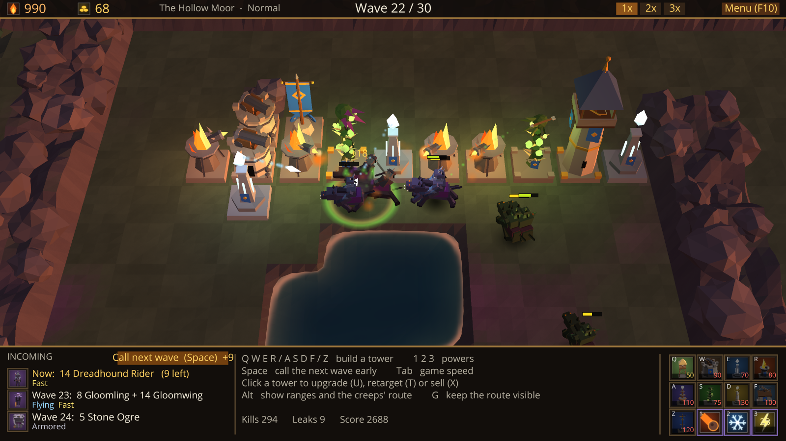
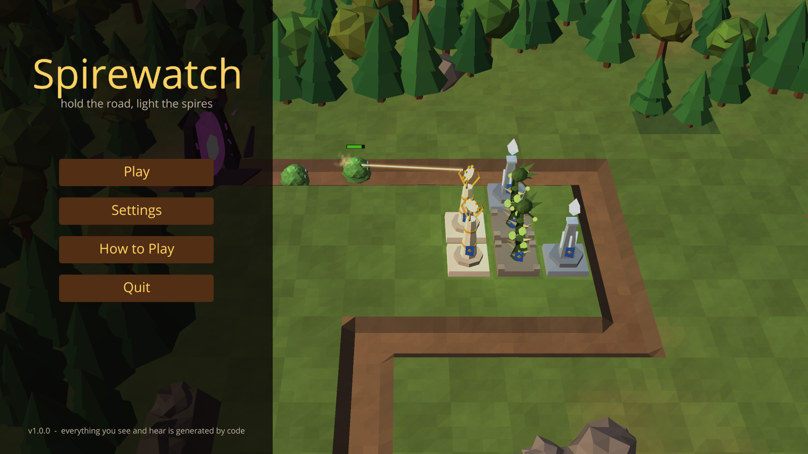
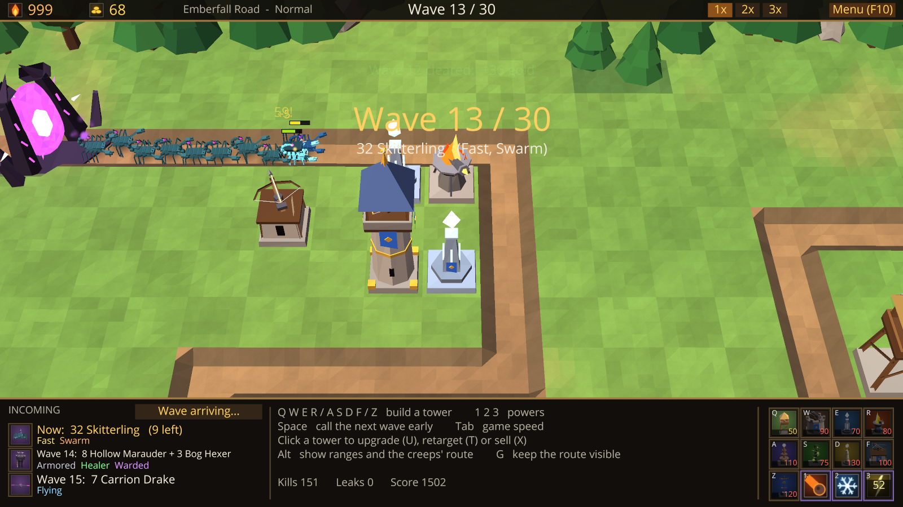
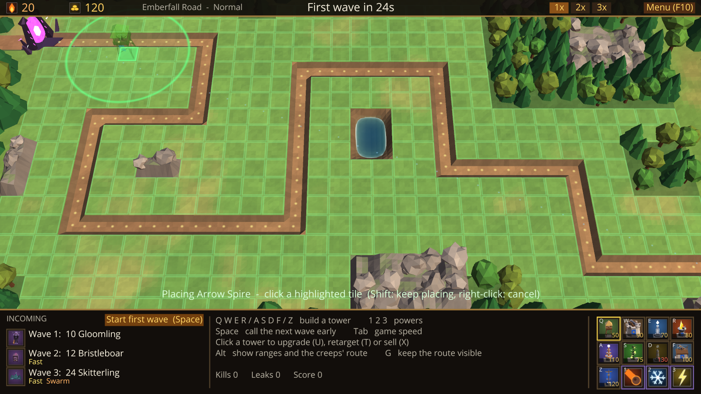
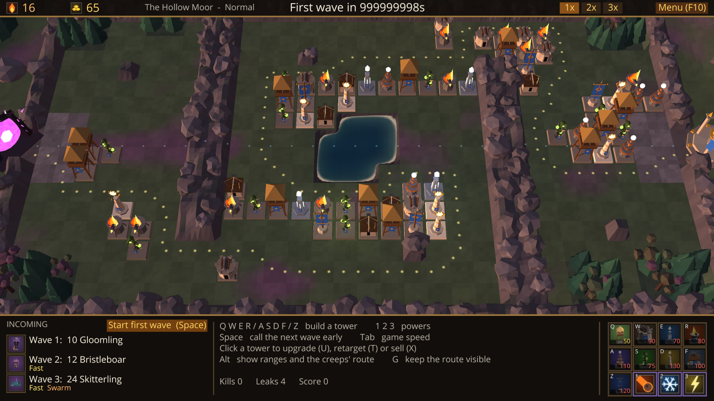
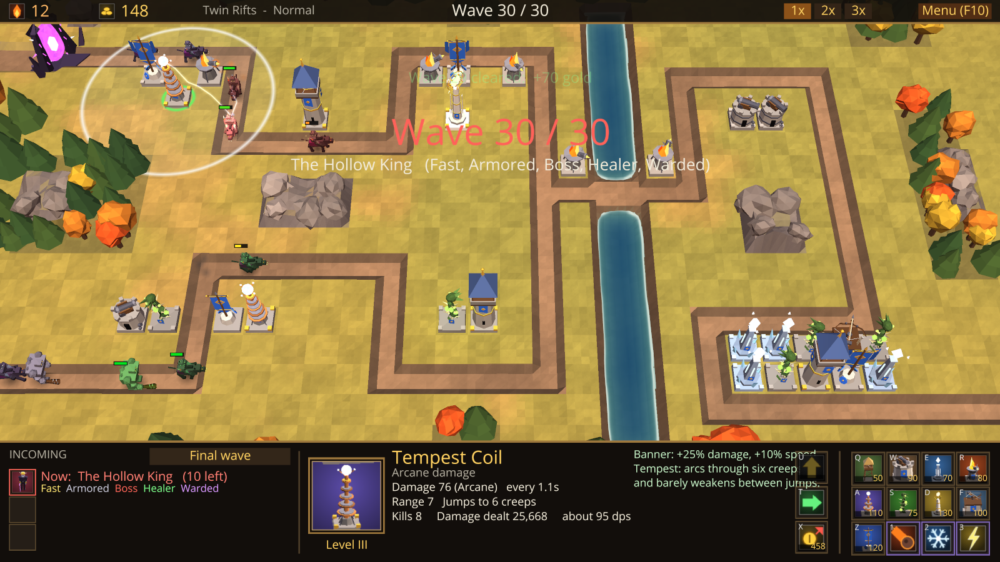
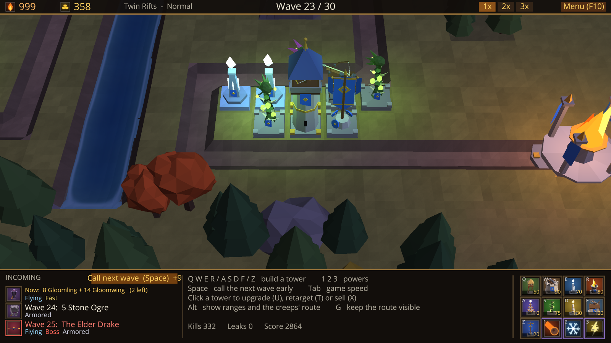
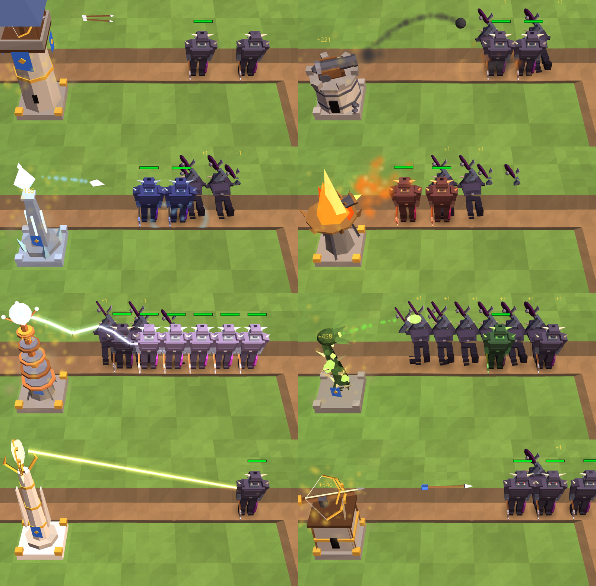

# Spirewatch

A fantasy tower defense built in Python with [Ursina](https://www.ursinaengine.org/) / Panda3D.
Creeps pour out of a rift and march on the Heartfire. You raise towers along their road, or on the open moor
where your towers *are* the road, and hold out for thirty waves.

Everything is generated in code: the terrain, every tower, creep and icon, the sounds and the music. There are no
image, model or audio files.


▶ **[Watch the 42-second gameplay video with sound](docs/gameplay.mp4)**



| | |
|---|---|
|  |  |
|  |  |
|  |  |

## Features

- **Nine towers, three levels each.** Every level has its own model, and the third unlocks a perk.
- **Nineteen creeps** on eleven animated rigs: goblins, boars, scorpion swarms, armored marauders, regenerating
  crawlers, healers, oozes that split, ethereal wraiths, flyers, and four bosses.
- **Match-ups that matter.** Four attack types against five armor types, plus armor that venom can strip below zero.
  The wave preview tells you what is coming and what it is weak to.
- **Three maps**
  - *Emberfall Road:* one long winding road with terraces to build on.
  - *Twin Rifts:* two rifts whose roads meet at a river ford.
  - *The Hollow Moor:* no road at all. Your towers are the walls; build a maze, but you can never seal it.
- **Three powers on cooldown:** Meteor, Frost Nova and Overcharge.
- **30 waves or endless**, on Easy, Normal or Hard, with a best score and up to three stars per map.
- **Quality of life:** grid hotkeys, a ghost with range ring and live route preview while placing, five targeting
  modes per tower, full refund if you sell a tower within 4 seconds, 1x / 2x / 3x speed, auto-call option.
- **A day and night cycle** with glowing towers, and a main menu that plays itself in the background.



## Download and play (Windows)

1. Download **[Spirewatch-v1.0.0-windows-x64.zip](https://github.com/aoancea/Spirewatch/releases/latest/download/Spirewatch-v1.0.0-windows-x64.zip)** from the [latest release](https://github.com/aoancea/Spirewatch/releases/latest).
2. Unzip it anywhere.
3. Run `Spirewatch\Spirewatch.exe`.

No Python or installation is needed. Windows may show a SmartScreen warning for an unsigned app: choose *More info → Run anyway*.

## Run from source

Requires Python 3.11+ (developed on 3.12, Windows).

```bash
python -m venv .venv
.venv\Scripts\activate            # source .venv/bin/activate on Linux / macOS
pip install -r requirements.txt
python main.py
```

| Command | What it does |
|---|---|
| `python main.py --quick emberfall_road normal` | Skip the menus: map, difficulty |
| `python main.py --quick hollow_moor hard --endless` | Endless mode on the maze map |
| `python main.py --size 1920x1080 --novsync` | Window size, uncapped frame rate |
| `python main.py --sim all` | Headless balance run (see *Testing and balance*) |

The first launch writes the generated sounds to `cache/` (well under a second); later launches reuse them.
Settings are stored in `settings.json` and best results in `scores.json`, next to the game.

## Controls

| Input | Action |
|---|---|
| `Q W E R` / `A S D F` / `Z` | Pick a tower to build, then click a highlighted tile |
| Shift + click | Keep placing the same tower |
| Left click | Select a tower or a creep |
| `U` / `T` / `X` | Upgrade, change targeting, sell the selected tower |
| `1` `2` `3` | Meteor, Frost Nova, Overcharge: then click the target area |
| Space | Call the next wave now (pays gold for every second skipped) |
| Tab | Game speed: 1x, 2x, 3x |
| Alt (hold) / `G` | Show ranges, health bars and the creeps' route |
| Arrow keys, screen edges, middle-mouse drag | Scroll the camera |
| Mouse wheel | Zoom |
| Right click, Esc | Cancel, deselect, pause menu (also F10) |

## Towers

| Key | Tower | Cost | Damage | What it is for |
|---|---|---|---|---|
| Q | Arrow Spire | 50 | Pierce | Cheap and fast. Shreds light creeps, weak against plate. Level 3 shoots two targets. |
| W | Cannon Bastion | 90 | Blast | Splash damage. Cracks heavy armor and flattens swarms. Cannot hit flyers. |
| E | Frost Obelisk | 70 | Elemental | Slows an area by 30 to 50%. Level 3 can freeze creeps solid. |
| R | Ember Brazier | 80 | Elemental | Short-range jet of flame that sets everything in it burning. Burns through wards. Ground only. |
| A | Storm Coil | 110 | Arcane | Chain lightning across 3 to 6 creeps. The answer to wraiths. |
| S | Venom Thorn | 75 | Poison | Damage over time that ignores armor, strips it away and stops regeneration. |
| D | Sun Prism | 130 | Arcane | A beam that ramps up to 4x on one target. Your boss killer. |
| F | Sky Ballista | 100 | Pierce | Very long range, double damage to flyers. |
| Z | War Banner | 120 | - | Aura: nearby towers deal up to +35% damage and attack up to 20% faster. |

| | Unarmored | Light | Heavy | Warded | Ethereal |
|---|---|---|---|---|---|
| **Pierce** | 1.0 | **1.5** | 0.6 | 1.0 | 0.5 |
| **Blast** | **1.25** | 0.8 | **1.5** | 0.8 | 0.5 |
| **Arcane** | 1.0 | 1.0 | **1.25** | 0.5 | **1.5** |
| **Elemental** | 1.0 | 1.1 | 0.8 | **1.5** | **1.25** |

All stats, costs, waves, creeps and map layouts live in editable JSON files in [`data/`](data). Maps are drawn as
rows of characters, so a new layout is a few lines of text. Change a number and restart to rebalance.

## How it is built

| Area | What's inside |
|---|---|
| `core/` | Match rules, game loop, camera, bot, headless simulator, procedural audio, scripted autotests |
| `world/` | The grid and its flow field, terrain sculpted from the layout, trees, rocks, rift gates, the Heartfire shrine, sky |
| `creeps/` | Creep logic (movement, status effects), wave schedule, eleven procedural rigs, GPU rigid skinning |
| `towers/` | Tower logic (five attack kinds, targeting, upgrades, auras) and the 27 procedural models |
| `combat/` | Damage rules, projectiles, the three powers, batched particles, beams and lightning |
| `ui/` | HUD, build card, tooltips, menus, portraits rendered offscreen from the real models |

Technical notes:

- **Pathing.** Creeps follow a flow field (Dijkstra distance to the Heartfire over walkable cells) and cut corners
  along any clear line of sight, so one mechanism serves both the fixed roads and the mazes. Placing a tower on
  open ground recomputes the field; a placement that would cut a rift or any creep off from the exit is refused.
- **Rendering.** Each creep is skinned on the GPU in one draw call. Shadows, health bars, range rings, the build
  grid, particles and beams are one batched draw call each.
- **Rules and graphics are separate.** A match runs with or without a window, which is what makes the balance
  simulator possible: a full 30-wave game in about 5 seconds.

## Testing and balance

Scripted autotests drive the real game, take screenshots and assert behaviour. All of them pass in the current build.

| Command | Covers | Checks |
|---|---|---|
| `python main.py --autotest t1` | Map, road pathing, leaks, flyers, day and night | 5 |
| `python main.py --autotest t2` | Every tower kind and perk, damage formula, upgrades, selling, creep traits, powers | 31 |
| `python main.py --autotest t3` | Maze map: walls lengthen the route, sealing is refused, creeps re-path | 5 |
| `python main.py --autotest ui` | Hotkeys, placing, selecting, upgrading, powers, speed, pause menu | 21 |
| `python main.py --autotest menu` | Main menu, setup, defeat, victory, continuing into endless | 9 |
| `python main.py --autotest perf` | 160 creeps against 151 towers (about 105 fps on the development machine) | 1 |

`show`, `fx`, `tips`, `shots` and `bot` only take screenshots. Screenshots and a log land in `screenshots/autotest/`.
The tests never touch your settings or scores.

Balance is tuned against a bot that buys whatever is worth most against the next few waves:

```bash
python main.py --sim all            # every map on every difficulty
python main.py --sim all powers     # the same, with the bot also using the three powers
python main.py --sim twin_rifts hard
python tools/capacity.py            # health each tower type stops per gold spent
```

| Map | Easy | Normal | Hard | Hard, bot uses powers |
|---|---|---|---|---|
| Emberfall Road | win, 30/30 lives | win, 11/20 | lost on wave 14 | win, 3/10 |
| Twin Rifts | win, 30/30 | win, 12/20 | lost on wave 20 | lost on wave 20 |
| The Hollow Moor | win, 30/30 | win, 13/20 | lost on wave 8 | lost on wave 15 |

The bot places towers greedily and never calls a wave early, so treat this as a floor: Normal is winnable
without powers, Hard expects you to use them and to place better than a greedy bot does. The bot has not beaten Hard on Twin Rifts or the moor.

## Recording the video

The gameplay video above is filmed by the game itself:

```bash
pip install imageio-ffmpeg          # bundles ffmpeg; not needed to play
python tools/video.py
```

It runs a scripted storyboard on a fixed 1/30 s clock, pipes every frame to ffmpeg, and writes `docs/gameplay.mp4`
and `docs/gameplay.gif`. The soundtrack is mixed offline from the sound events the game raised while filming, using
the same procedural sounds and music, so nothing is captured from the speakers.

## Build the Windows executable

```bash
pip install pyinstaller
.\build_exe.bat
```

The game is written to `dist/Spirewatch/` (about 180 MB). Zip that folder to share it. The packaged build
passes the same autotests: `dist\Spirewatch\Spirewatch.exe --autotest t2`.

## Credits

Code, models, textures, sounds and music are procedurally generated by this project. The world, creeps and towers
are original creations. It shares its low-poly mesh, shader and rig foundations with *Dusk of Kings* and
*Ember Wastes*.

Licensed under the [Apache License 2.0](LICENSE).
